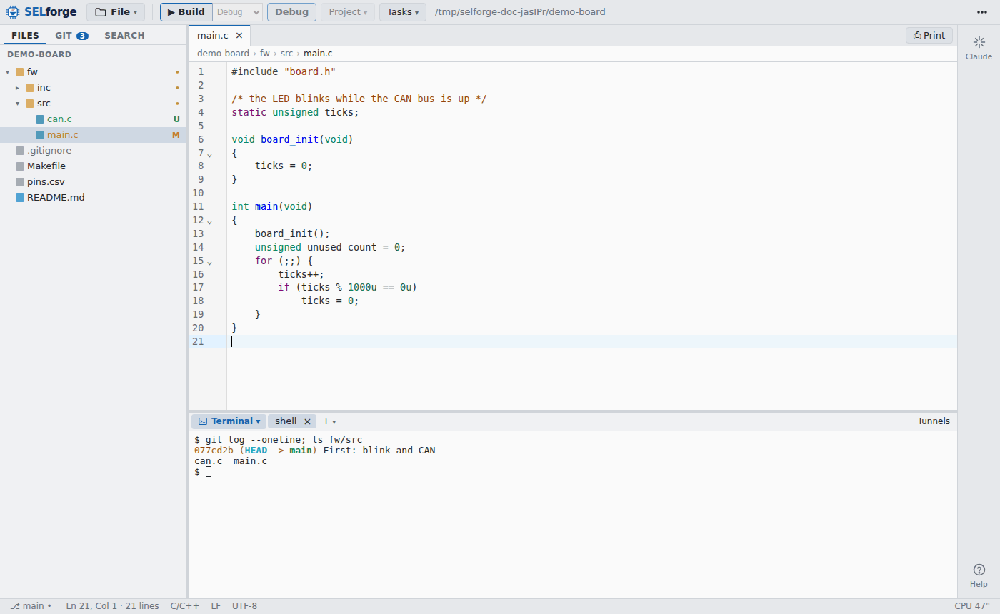
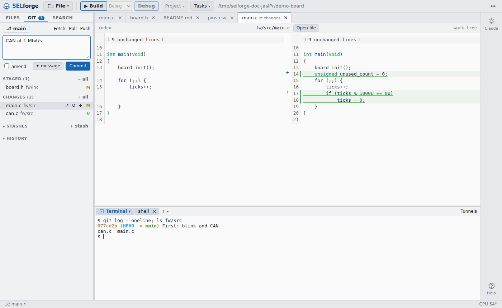
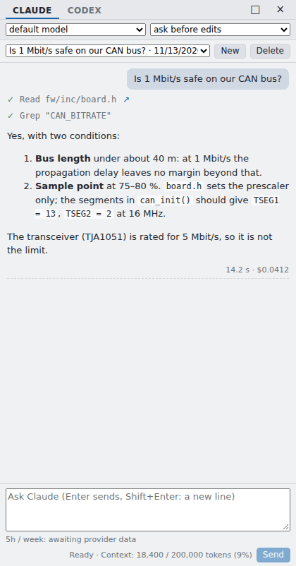

<p align="center">
  
</p>

<h1 align="center">SELforge</h1>

<p align="center">Embedded Development Studio: a light editor for C++, Python, Markdown and HTML, local or over SSH</p>

A light editor for C++, Python, Markdown and HTML, local or over SSH, with
terminals, tunnels and git; the editor of the SEL suite, next to SELect (`sel-pinmux`) and SELscope
(SEL `tools/gdb-web`, `sel-gdb-web`).

**Why:** VS Code brought the (passively cooled) machine down: cpptools ate all the RAM and
swap, heavy builds ran in parallel until the SSDs shut down from the heat. So SELforge:

- has **no indexer**; finds files on demand (`git ls-files`, a walk past `node_modules`,
  `build`, …), nothing runs in the background. clangd only when turned on for a folder,
  with a memory limit, and stopped when idle
- watches nothing: the open files and the tree are checked when the window comes back
  (after a `git checkout` or a build in the terminal)
- one Node.js process and one browser window; nothing installed on a remote machine
  (SSH: SFTP and a shell, no remote server)
- runs what it runs one at a time (the tasks of M4: niced, a bounded `-j`)

<p align="center"></p>

## Installing

The packages are on the [latest release](https://github.com/ArkadiuszRaj/SELforge-release/releases/latest); each carries everything it needs (Node.js
included):

| system | file | how |
|--------|------|-----|
| Windows 10/11 | `selforge-<version>-win64-setup.exe` | run it: installed for you, no administrator rights; the Start menu. Not signed: SmartScreen asks once, **More info → Run anyway** |
| Windows, portable | `selforge-<version>-win64.zip` | unzip anywhere, run `selforge.exe` |
| Debian, Ubuntu | `selforge_<version>_amd64.deb` | `sudo apt install ./selforge_<version>_amd64.deb`; the menu entry, `selforge` on the command line |
| any Linux | `selforge-<version>-x86_64.AppImage` | `chmod +x` and run it |
| macOS (Apple silicon) | `selforge-<version>-macos-arm64.tar.gz` | `tar xzf …`, then `./install.sh` in its folder (`--user`: without the password) |

On Windows the tasks and the SEL tools of a local folder are missing (they need a POSIX shell).

The SHA-256 of every file is in the notes of the release.

## Updates

SELforge looks for a newer release by itself and offers it at the bottom right: **Upgrade** fetches it, checks it against the SHA-256 of the release and installs it, **Start the new version** opens the same files in it. **Later** and **Skip this version** keep it as it is.

## Running it

```sh
selforge                    # the start page: recent folders, SSH hosts, a folder browser
selforge ~/git/other/SELect # that folder
selforge src/main.cpp       # its folder, the file opened
selforge --app .            # in a window of its own (Chromium, Chrome, Edge)
selforge . --no-open        # only the server: open the printed address yourself
```

## Using it

- **tree** on the left: click opens; right click: new file / folder, rename, delete (to the
  trash), copy the path, a terminal in that folder
- **Ctrl+P** go to a file by a few letters of its path; **Ctrl+S** save, **Ctrl+Shift+S**
  save all; **Alt+W** or a middle click closes a tab (Ctrl+W closes the app window);
  **Ctrl+PgUp / PgDn** the tabs
- the editor (CodeMirror 6): highlighting of C/C++, Python, Markdown (with the code blocks),
  HTML, CSS, JS/TS, JSON, YAML, shell, CMake, TOML, INI, diff, Dockerfile; Ctrl+F find and
  replace, Ctrl+D the next match, Alt+click more cursors, folding, bracket matching;
  the indentation of each file guessed from it (tab, 2, 4 spaces), CRLF kept
- a file changed on the disk: reloaded when it has no changes here; with changes, the tab
  turns yellow and saving asks before overwriting
- **Markdown** opens rendered (images of the folder, tables, **Mermaid** diagrams drawn as
  SVG); **Split** shows the text next to it, **✎ Edit** the text only. An **SVG** the same way
- **⎙ Print** (Ctrl+Alt+P): the rendered Markdown, an image, or the code with its colours
  and line numbers (the selected lines, else the file); **Save as PDF** in the print dialog
  makes the PDF
- **CSV / TSV** in "rainbow" colours, a colour per column (the separator guessed: `,` `;`
  tab `|`); a field's column and its header name on hover
- **images** (PNG, JPEG, GIF, WebP, …: fit, 1:1 with a click, Ctrl+wheel zoom) and **PDF**
  (the browser's own viewer) open in a tab
- **Download** (right click in the tree): a file, or a folder as `.tar.gz`, to this
  machine's downloads; from a host too
- **Ctrl+`** the terminals (Ctrl+Shift+`: a new one); Ctrl+Shift+C / V copy and paste
- **Serial**: a serial monitor next to the terminals: the ports of the folder's machine
  (over SSH: the host's; the project's ST-LINK first), the rate, the time of each line, hex,
  a filter, a line sent with its ending, Save to a .log; `stty` and `cat`, nothing to install
  (Linux and macOS: `/dev/ttyACM*`, `/dev/ttyUSB*`, `/dev/cu.usbmodem*`, `/dev/cu.usbserial*`)
- the sun / moon: light or dark theme

## Over SSH

The start page lists the hosts of `~/.ssh/config` (Host, HostName, User, Port,
IdentityFile, IdentitiesOnly, ProxyJump, ProxyCommand, ForwardAgent, HostKeyAlias,
UserKnownHostsFile, Include; Match blocks are skipped), or takes `user@host:port`. A click
connects and browses the host's folders; the folder opened is then edited over SFTP, its
terminals are shells on the host (in the folder), Ctrl+P lists its files with `git ls-files`
(or `find`) run there. Nothing is installed on the host.

- the way in, as ssh: the agent (`SSH_AUTH_SOCK`), the keys (a passphrase asked once),
  the password; the answers are kept in memory while SELforge runs, so a dropped
  connection comes back by itself
- the host key checked against `known_hosts` (hashed names too): an unknown one is shown
  with its fingerprint and, when trusted, added (hashed, as Ubuntu's ssh does); a changed
  one is refused (`ssh-keygen -R host` when the host was really reinstalled)
- deleting on a host is for good (no trash there): the dialog says so
- **tunnels**: when a remote terminal prints a local address (`listening on
  http://127.0.0.1:4410/?t=…` of an AppImage started with `--no-open`, `make run`, a vite,
  `python3 -m http.server`), the tunnel is made and the page opens in an app window of its
  own at once, as VS Code does (a local port, the same number when free); off in
  Settings…: a bar offers it. A local terminal's address: the bar only (the program may
  open its own window). **Tunnels** in the terminal
  bar lists them, adds one by hand (a port of the host, or of a machine it sees), closes
  them. A link clicked in a terminal goes the same way.
- **+X11**: a shell with X11 forwarded, the host's windows on this display (the display's
  cookie from `xauth`); **+local** a shell on this machine

## Git

<p align="center"></p>

**Git** on the left (Ctrl+Shift+G; Files: Ctrl+Shift+E), with the number of changed files;
the tree marks them too (M changed, U new, D deleted, a dot on the folders holding them).
All of it is the `git` command in the folder, locally or on the host, one command at a
time; it never asks for anything (no terminal): a push that needs a password fails with
git's message (the agent, or a push in a terminal, then).

- the branch: a click switches (a remote branch: a local one tracking it) or, by typing a
  new name, creates one from here; ↑ / ↓ against the upstream; **Fetch**, **Pull**, **Push**
  (the first push of a branch sets its upstream)
- the message and **Commit** (Ctrl+Enter); nothing staged: all the tracked changes
  (`commit -a`), after asking; **amend** starts from the last message
- **Staged** and **Changes**: a click shows the change next to the old version (the index
  against HEAD, or the work tree against the index), the unchanged parts folded; on the
  row: open the file, discard (an untracked file: delete), stage / unstage; all at once on
  the heading
- several files at once: Ctrl/⌘+click, Shift+click, then a right click: stage, unstage,
  discard / delete
- **History**: the last 200 commits with their branches and tags; a click lists the files
  of one, a file its change in that commit
- a folder inside a repository: the lists are the whole repository's
- a merge, a rebase or a cherry-pick stopped half way is said; it is finished (or aborted)
  in a terminal

## AI: Claude and Codex



**AI** on the right edge (Ctrl+Alt+C) talks about the folder open, with **Claude Code** or
**Codex** on two tabs (both may work at once). They read, search, edit and run commands in
the folder; edits and commands ask first, as the permissions chosen say. Ctrl+Alt+C in the
editor puts the selection into the question, **✦ AI** in Problems asks about a compiler
message, **✦ message** in Git writes the commit message, **✦ AI** resolves a conflict.

**What it needs**: the CLI of the provider, installed and logged in **on the folder's
machine**: this computer for a local folder, **the SSH host** for a folder there (it runs
there, in the folder, as your user). Nothing is needed on the machine of the browser, and
SELforge keeps no API key: the CLI uses its own login (your Claude or ChatGPT account).

```sh
# Claude Code
curl -fsSL https://claude.ai/install.sh | bash
claude                      # once, in a terminal: log in
# Codex
npm install -g @openai/codex
codex login
```

The conversations are kept in the folder, one file each (`.selforge/chats/`, out of git);
the panel shows the context used and the account's 5-hour and weekly limits.

## Tasks and the SEL tools

**Tasks ▾** lists what the folder has to run: the targets of its Makefile, CMake
(configure / build / clean in `build/`), the scripts of package.json, and your own in
`.selforge/tasks.json` (`[{ "label": …, "command": …, "cwd": … }]`; the menu creates a
template). **Ctrl+Shift+B** runs the last one again.

- **one task at a time**: starting another asks to stop the one running
- each one niced (`nice 10`, `ionice` best-effort lowest) with a bounded number of jobs:
  `MAKEFLAGS=-jN`, `CMAKE_BUILD_PARALLEL_LEVEL=N`; N is a third of the cores, at most 4
  (Settings…)
- **thermal guard** (a local task): the whole task (make and its compilers) is stopped
  (SIGSTOP of its process group) when the CPU reaches 85 °C or a disk 60 °C, and continued
  10 °C / 5 °C below; the status bar shows the temperatures. Disks: NVMe, SATA ones with
  `sudo modprobe drivetemp` (else none are shown). The limits in Settings…
- a task's tab stays when it ends, ✓ or ✗; `file:line:col` of gcc, clang, Python is a link
  to the file at that place

**SELect** and **SELscope** in the toolbar start the planner (`sel-pinmux`, on the pin
sheet shown or the folder of the file shown) and the debugger front end (`sel-gdb-web`) in
a terminal tab; their page opens in a window of its own as soon as they serve it (over SSH:
through a tunnel). They are looked for in this order:

1. the SEL of the project itself, in or above the folder (a SEL tree's `tools/pinmux` and
   built `tools/gdb-web`, a consumer's `import/SafeEmbeddedLibrary`, the checkouts next to
   it): its version fits the project's files
2. the installed packages (`sel-pinmux`, `sel-gdb-web` on PATH)
3. SELforge's own: SEL is a submodule here, `import/SafeEmbeddedLibrary`, pinned to a
   release as in HAPLA (shallow; `make tools` builds its SELscope). A newer release:
   `git -C import/SafeEmbeddedLibrary fetch --depth 1 origin tag vX.Y && git -C
   import/SafeEmbeddedLibrary checkout vX.Y`, then commit the submodule

`"tools": { "select": "…", "selview": "…" }` in `~/.config/selforge/settings.json` gives the
commands by hand.

## SEL projects

**New SEL project…** (start page) makes a firmware project on SEL: the board or any part
SEL builds (H503/H523/H533/H563, G071, G0B1 with SEL v0.6 to v0.8), RTOS, cooperative RTOS or a
superloop, the tasks (each a generated handle and a body of yours), SEL as a submodule
pinned to a release, CMake, SELect's hardware files. **▶ Build** and **🐞 Debug** (SELscope:
flash, stop at reset) in the toolbar, **Project ▾** for Configure, Flash, SELect. Flash and
Debug use the chosen ST-LINK, or the only one connected: never the first of several.

## Licence

Copyright © 2026 Arkadiusz Raj (hijax_pl). GPL-3.0-only (`LICENSE`).

